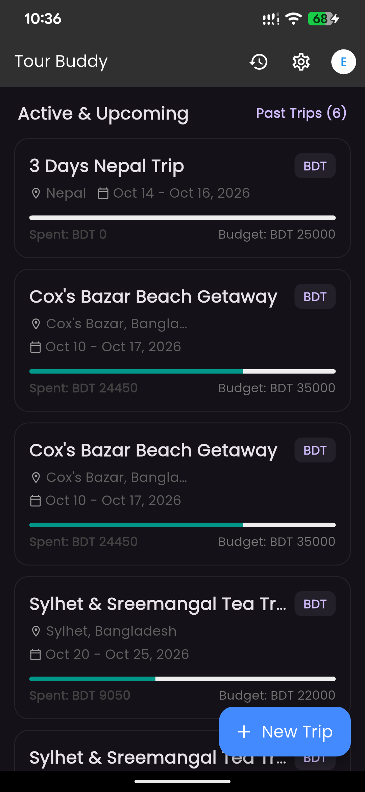
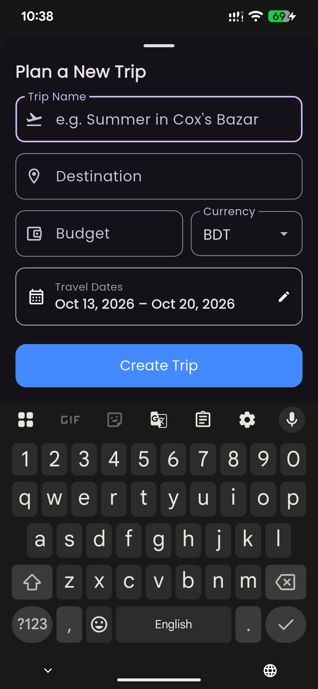
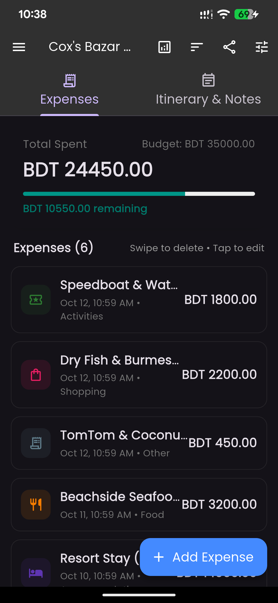
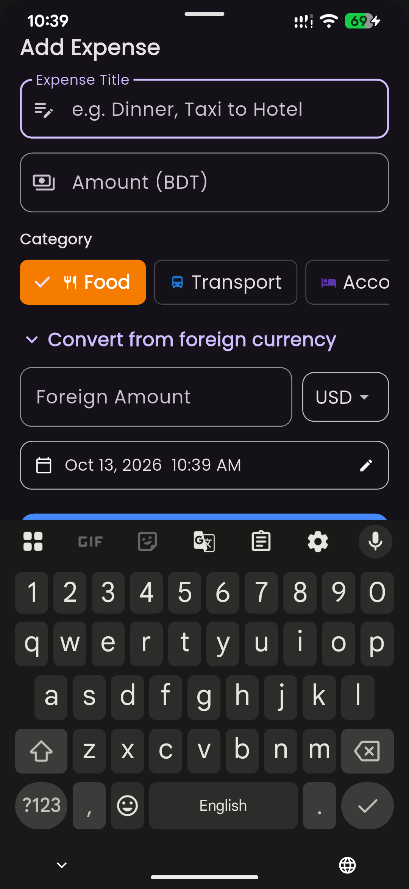
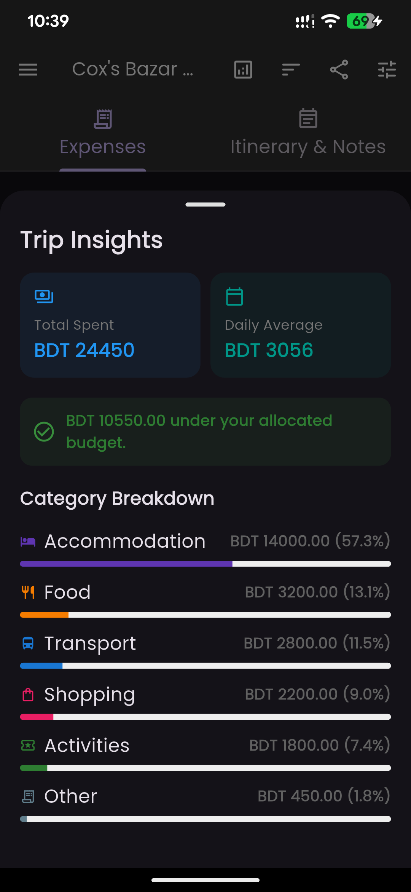
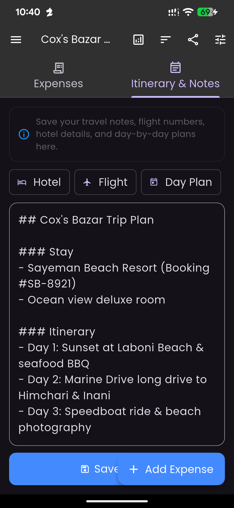
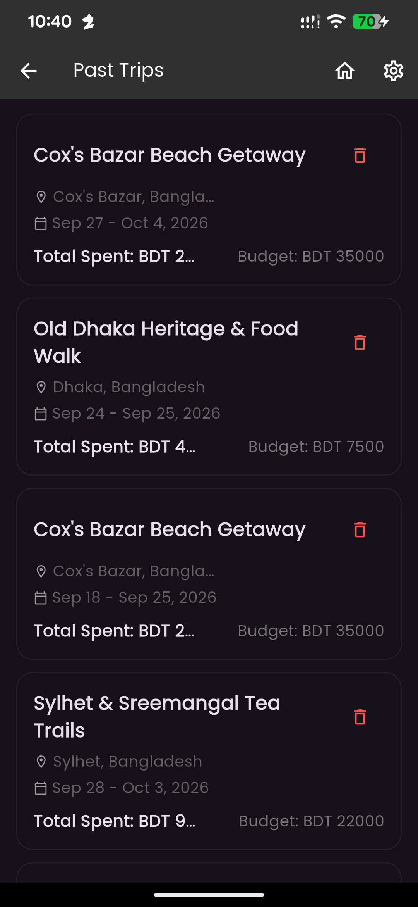
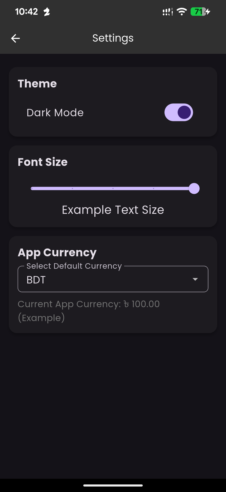

# Tour Buddy

[-2ea44f?style=for-the-badge&logo=android&logoColor=white)](https://github.com/meawsin/Tour_Buddy/releases/download/v2.0/app-release.apk)
[](https://github.com/meawsin/Tour_Buddy/releases/latest)
[](https://github.com/meawsin/Tour_Buddy)
[](LICENSE)

**Tour Buddy** is a modern, offline-first travel companion and budget management application built with Flutter and Firebase. Engineered for travelers seeking effortless multi-currency expense tracking, interactive itinerary planning, and seamless multi-device synchronization without clutter or visual noise.

---

## Direct Download & Quick Install

You can install Tour Buddy directly on your Android device without waiting for the Google Play Store:

* **[Download Latest APK (v2.0)](https://github.com/meawsin/Tour_Buddy/releases/download/v2.0/app-release.apk)** (Standalone Release Binary, 25.9 MB)
* Once downloaded, open the notification or file manager and tap **Install**.
* If prompted, enable *"Install unknown apps"* for your browser.

---

## App Showcase

Captured on a physical Google Pixel 6 Pro running Android 14.

| Dashboard & Overview | Plan New Trip |
| :---: | :---: |
|  |  |
| **Active & Upcoming Journeys**<br>Visual budget progress meters and spending telemetry | **Trip Planner Modal**<br>Date-range calendar, custom budget limits, and currency selection |

| Expenses Ledger | Add & Convert Expense |
| :---: | :---: |
|  |  |
| **Dual-Tab Travel Ledger**<br>Multi-criteria sorting, category badges, and quick-delete actions | **Smart Expense Logging**<br>Foreign currency auto-conversion and custom date/time picker |

| Trip Analytics & Insights | Markdown Itinerary Notebook |
| :---: | :---: |
|  |  |
| **Spending Breakdown**<br>Daily average burn rate and category distribution meters | **Itinerary Planner**<br>Fast-insert reservation templates and markdown travel notebook |

| Past Trips Archive | Settings & Customization |
| :---: | :---: |
|  |  |
| **Travel Archive**<br>Automatic date-based archiving and historical budget metrics | **Preferences & Accessibility**<br>Dark/Light mode switch, dynamic font-size slider, and currency configuration |

---

## Key Features & Capabilities

### Trip Planning & Budget Management
* **Multi-Trip Lifecycle Management**: Organizes trips into **Active & Upcoming** and **Past Trips** with automated date-based archiving.
* **Integrated Date-Range Calendar**: Select departure and return dates with a single fluid calendar widget.
* **Non-Negative Budget Safeguards**: Validates input to ensure budgets and logged costs are non-negative.
* **Multi-Currency Defaults**: Create trips in any supported home currency (BDT, USD, EUR, GBP, INR) inheriting from your global settings preference.
* **Dynamic Budget Gauges**: Real-time progress bars provide immediate visual feedback as spending approaches or exceeds the allocated ceiling.

### Expense Tracking & Intelligence
* **Six Structured Categories**: Categorization across **Food**, **Transport**, **Accommodation** (with automatic alias matching for *Stay* and *Hotel*), **Shopping**, **Activities**, and **Other**.
* **Foreign Currency Conversion**: Log expenses in foreign currencies while on the road; the app automatically calculates and logs the converted amount against your trip's home currency.
* **Interactive Date & Time Picker**: Record transactions with precise historical or scheduled timestamps rather than being limited to the current instant.
* **Multi-Criteria Sorting**: Sort transactions by newest first, oldest first, highest amount, lowest amount, or category.
* **Swipe-to-Delete with Undo**: Delete transactions with a horizontal swipe, backed by an immediate SnackBar undo action.
* **Trip Insights**: View your average daily burn rate, total spending summary, and an itemized category expenditure breakdown.

### Travel Itinerary & Notes
* **Markdown Travel Notebook**: Keep flight confirmations, hotel addresses, packing checklists, and daily schedules alongside your finances.
* **One-Tap Template Pills**: Quick-insert structured templates:
  * `+ Hotel`: Check-in, check-out, confirmation number, and address fields.
  * `+ Flight`: Airline, flight number, departure, arrival, and terminal details.
  * `+ Day Plan`: Structured morning, afternoon, and evening agenda.
  * `+ Checklist`: Pre-formatted interactive markdown checklists.
* **Live Auto-Save**: Itinerary notes persist automatically to the trip model without requiring manual save actions.

### Offline-First Architecture & Cloud Synchronization
* **Cached Foreign Exchange Rates**: Real-time exchange rates from ExchangeRate-API are cached in local persistent storage (`SharedPreferences`), ensuring offline conversions continue working seamlessly during flights or in remote destinations.
* **Local Persistence with Cloud Sync**: Full read and write functionality when completely disconnected from the internet. When connectivity is restored, data synchronizes with Cloud Firestore.
* **Non-Intrusive Google Cloud Backup**: Optional Google Sign-In lets travelers back up their trips to Firebase and restore them across multiple devices.

### Accessibility & Material 3 Design
* **Clean Typography**: Distraction-free typography with Google Fonts and native Material Design 3 components.
* **Adaptive Font Scaling**: Built-in font scaling slider allows real-time UI text adjustments for enhanced readability.
* **Theme Support**: High-contrast Dark Mode and clean Light Mode.
* **Keyboard-Aware Modal Sheets**: Bottom sheets intelligently adjust padding and scrolling when on-screen virtual keyboards appear.

---

## Tech Stack & Architecture

| Component | Implementation |
|---|---|
| **Framework** | Flutter (Dart SDK `^3.5.3`) |
| **State Architecture** | Provider (`TripProvider`, `ThemeProvider`) |
| **Cloud Backend** | Firebase Authentication & Cloud Firestore |
| **Local Storage** | SharedPreferences |
| **Exchange Rate Service** | ExchangeRate-API v6 with local rate caching |
| **Platform Compatibility** | Android (minSdk 23+, Android 6.0 through Android 15+) & iOS |

```text
lib/
├── firebase_options.dart      # Firebase initialization configuration
├── main.dart                  # Application entry point, theme setup, and MultiProvider bindings
├── theme_provider.dart        # Theme mode, typography scaling, and default currency state
├── models/
│   ├── trip.dart              # Core Trip model (dates, budget, destination, markdown notes, serialization)
│   ├── expense.dart           # Expense entity (amount, category, foreign currency rate, timestamp)
│   └── expense_category.dart  # Category taxonomy with icons, colors, and keyword alias resolution
├── providers/
│   └── trip_provider.dart     # Central data controller, Firestore offline queue & sample data seeder
├── screens/
│   ├── start_screen.dart      # Home dashboard, active trip cards, and trip creation sheet
│   ├── expense_screen.dart    # Dual-tab view: Expenses ledger, Insights dialog, and Itinerary notebook
│   ├── past_trips_screen.dart # Archived trips list with historical budget metrics
│   └── settings_screen.dart   # Appearance settings, font scaling slider, and default currency selector
└── services/
    └── currency_service.dart  # Multi-currency exchange rate fetcher with SharedPreferences caching
```

---

## Getting Started

### Prerequisites
* [Flutter SDK](https://docs.flutter.dev/get-started/install) (3.5.3 or higher)
* [Android SDK](https://developer.android.com/studio) (API level 23 or higher)
* Physical Android device or Android Virtual Device (AVD)

### Installation

1. **Clone the repository**:
   ```bash
   git clone https://github.com/meawsin/Tour_Buddy.git
   cd tour_buddy
   ```

2. **Install dependencies**:
   ```bash
   flutter pub get
   ```

3. **Firebase Configuration** *(Required for multi-device cloud sync)*:
   * Download `google-services.json` from your Firebase Console project.
   * Place the file in `android/app/google-services.json`.
   * Add your development and release SHA-1 / SHA-256 certificate fingerprints under your Android app in Firebase Console.

4. **Launch the application**:
   ```bash
   flutter run
   ```

---

## Quality Assurance & Testing

Tour Buddy includes automated unit and widget test suites covering model serialization, copyWith immutability, date formatting, daily burn rate calculations, category alias resolution, and all transaction sorting algorithms.

Run the test suite:
```bash
flutter test
```

Perform static analysis:
```bash
flutter analyze
```

---

## Building Standalone Release APK

To generate an optimized, standalone release APK for distribution or sideloading:

```bash
flutter build apk --release --android-skip-build-dependency-validation
```

The compiled APK will be generated at:
```text
build/app/outputs/flutter-apk/app-release.apk
```

---

## License

This project is licensed under the MIT License - see the [LICENSE](LICENSE) file for details.
